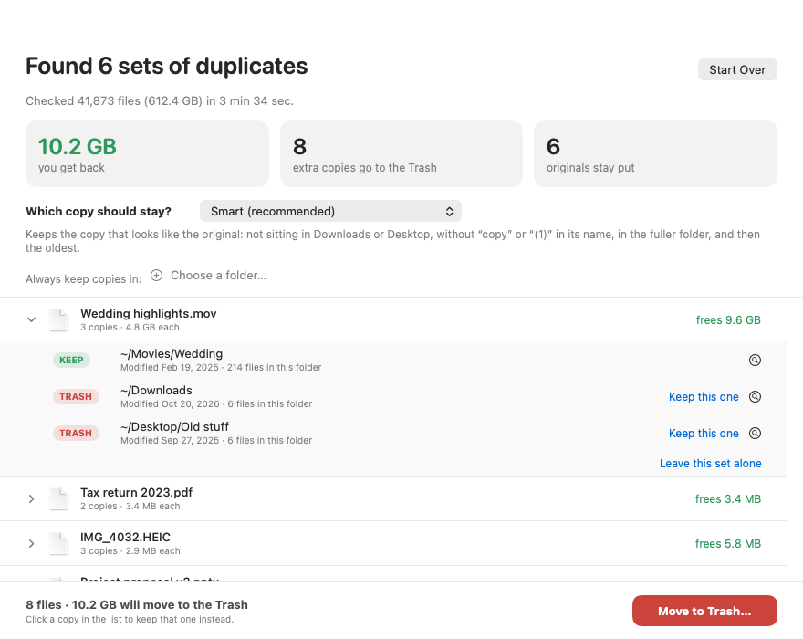

# Dupe Sweep

A free, open source Mac app that finds exact duplicate files, shows its progress, and moves the extra copies to the Trash. You drop folders on it, pick how it chooses the copy to keep, review the list, and press one button. Nothing is deleted for good and nothing leaves your Mac.



## What it does
- **Drop folders** on the window, or choose them. Folders on external drives work.
- **Shows progress** in four steps: finding files, finding files that could match, comparing what is inside (percent, speed, time left), working out what to keep.
- **You choose which copy stays.** Menu options: Smart (recommended), the copy in the larger folder, in the most recent folder, in the oldest folder, the newest file, the oldest file, the copy closest to the top. Pin folders so copies inside them always stay. Click any copy to keep that one instead, or leave a whole set alone.
- **Reports honest numbers.** "You get back" counts only space that really returns. Copies that share disk space with the original (APFS clones) count as zero.

## Safety
- Files go to the **Trash**. Dupe Sweep never deletes anything for good. "Put Everything Back" undoes the move.
- Each file is checked again just before it moves: it must be unchanged since the scan, and a kept copy must still exist.
- At least one copy of every set always stays.
- System folders, `~/Library`, apps, photo libraries and `node_modules` folders are never entered.
- Links are never followed. Hard links count as one file. iCloud-only files are counted but not read, so nothing gets downloaded.
- No network access, no telemetry, no account.

## How it finds duplicates
1. Walk the folders.
2. Group by size. A file whose size nobody shares cannot be a duplicate.
3. Fingerprint the bigger files (SHA-256 of the start, middle and end) to drop same-size files that differ.
4. Read the rest in full with SHA-256 (8 MB reads, a few files at once, low priority).
5. Same size and same hash means duplicate.

## Speed
Measured on a Mac Studio (M1 Ultra, 128 GB):
- On a 1.39 TB set (3,515 files), the engine took **4 min 10 s**. The Mac App Store duplicate finder used for comparison took **1 h 23 min 34 s**. Both reported the same 223 duplicate sets under the same rules.
- On a later 93 GB set, the Swift engine took 52.7 s against 60 s for the comparison tool.
- While scanning, the Mac stays responsive. The test in [`benchmarks/`](benchmarks/) found disk latency and timer jitter indistinguishable from an idle Mac.

The full method and benchmarks are in [How to Find Duplicate Files on a Mac](https://www.albgoldin.com/article/find-duplicate-files-mac).

## Install
1. Download the `.dmg` from the [Releases page](https://github.com/al-b-goldin/dupe-sweep/releases/latest).
2. Drag **Dupe Sweep** onto Applications.
3. Open it from Applications.

The app is not yet notarized by Apple, so macOS may say it cannot verify the app. This is expected. To open it once:
- Right-click (or Control-click) the app and choose **Open**, then click **Open** again. Or
- Open **System Settings > Privacy & Security**, scroll down, and click **Open Anyway** next to Dupe Sweep.

You only need to do this the first time. If you prefer, build it yourself (below).

Requires macOS 14 or later. Runs on Apple silicon and Intel.

## Build from source
Needs Xcode (Swift 5.9 or later).
```bash
swift test                       # 17 engine tests
swift build -c release && .build/release/DupeSweep --selftest
./scripts/build_app.sh           # writes dist/Dupe Sweep.app and dist/DupeSweep-1.0.dmg
```
The build script signs ad hoc. To sign and notarize with your own Apple Developer ID, run `DEVELOPER_ID="Developer ID Application: ..." NOTARY_PROFILE=... ./scripts/build_app.sh`.

## Layout
- `Sources/DupeEngine`: the scan, the keep rules, the Trash mover. No interface code. Tests are in `Tests/`.
- `Sources/DupeSweep`: the SwiftUI app. `--selftest` runs the whole flow on scratch files.
- `Sources/dupecheck`: a command line tool that scans a list of paths and prints counts and timing.
- `scripts/`: the app build and icon scripts.
- `benchmarks/`: the responsiveness test and its results.
- `docs/images/`: screenshots.

## Limits
- Only exact copies are found. Similar photos (resized or recompressed) are not detected.
- No automatic updates.

## Support
Dupe Sweep is free. If it saved you time, you can [buy me a coffee](https://buymeacoffee.com/albgoldin). The same link is in the app.

## Contributing and security
See [CONTRIBUTING.md](CONTRIBUTING.md) and [SECURITY.md](SECURITY.md). Licensed under the [MIT License](LICENSE).
