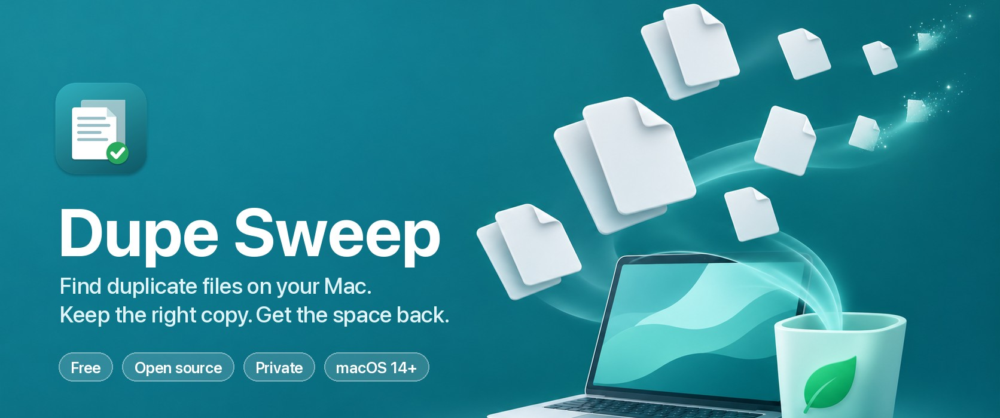
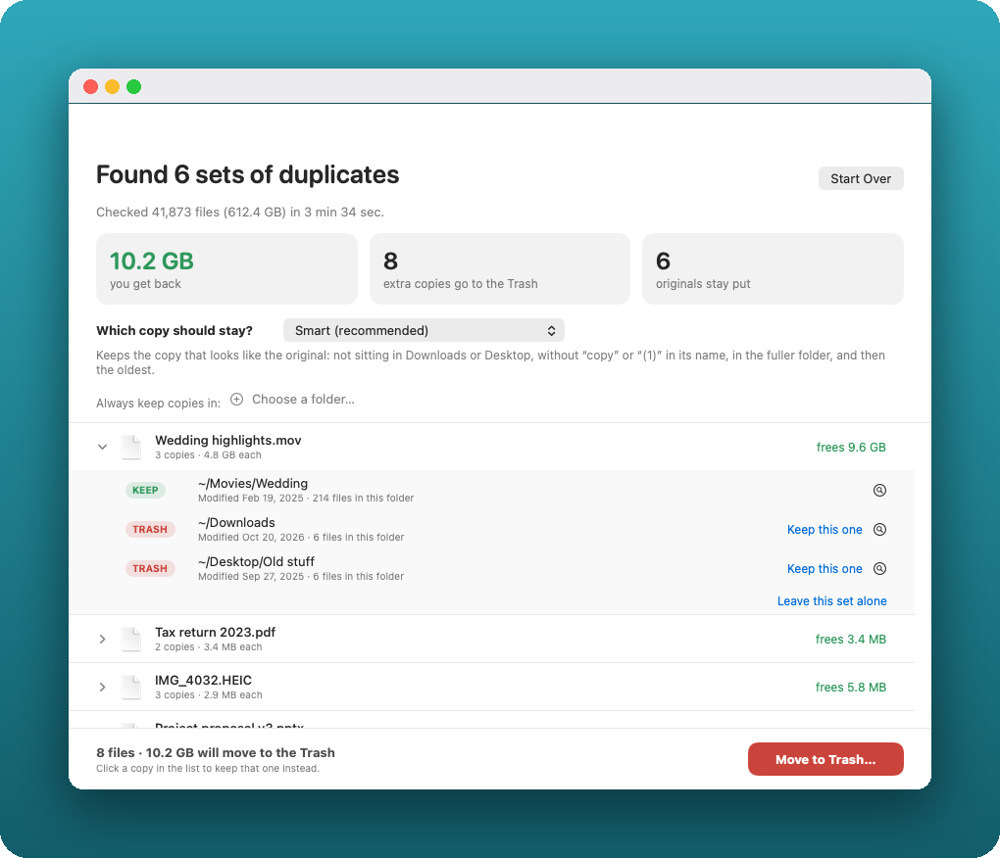
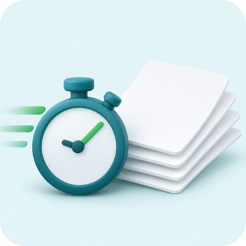
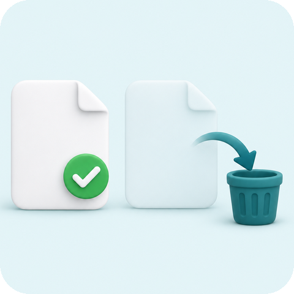
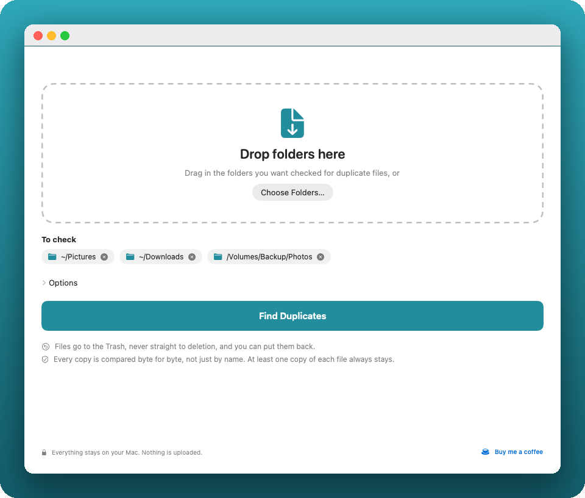
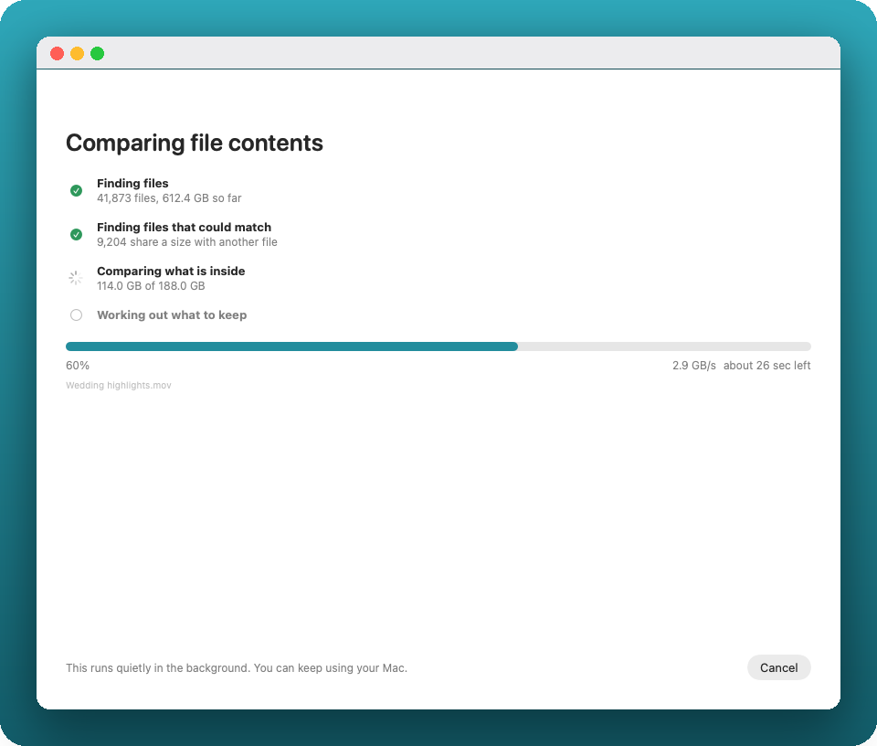
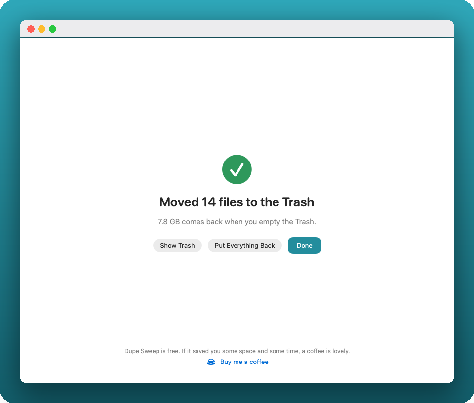

<p align="center">
  
</p>

<p align="center">
  <a href="https://github.com/al-b-goldin/dupe-sweep/releases/download/v1.0/DupeSweep-1.0.dmg"></a>
</p>

<p align="center">
  <a href="https://github.com/al-b-goldin/dupe-sweep/releases/latest"></a>
  
  
  <a href="LICENSE"></a>
  <a href="https://github.com/al-b-goldin/dupe-sweep/actions/workflows/ci.yml"></a>
</p>

<p align="center">
  <b>A free, open source Mac app that finds exact duplicate files and moves the extra copies to the Trash.</b><br>
  Drop folders on it, pick which copy stays, review the list, press one button.<br>
  Nothing is deleted for good. Nothing leaves your Mac.
</p>

<br>

<p align="center">
  <picture>
    <source media="(prefers-color-scheme: dark)" srcset="docs/readme/results-dark.png">
    
  </picture>
</p>

<br>

## Why Dupe Sweep

<table>
  <tr>
    <td width="50%" align="center" valign="top">
      
      <h3>Fast</h3>
      <p>1.39 TB in about <b>4 minutes</b> on a Mac Studio. A paid Mac App Store duplicate finder took <b>1 h 23 min</b> on the same files and found the same 223 sets.</p>
    </td>
    <td width="50%" align="center" valign="top">
      
      <h3>You choose which copy stays</h3>
      <p>Seven keep rules, folders you pin, or a click on any copy. Every file is marked <b>KEEP</b> or <b>TRASH</b> before anything moves.</p>
    </td>
  </tr>
  <tr>
    <td width="50%" align="center" valign="top">
      
      <h3>Nothing is lost</h3>
      <p>Extra copies go to the Trash, never deleted for good. <b>Put Everything Back</b> undoes the whole move. At least one copy of every set always stays.</p>
    </td>
    <td width="50%" align="center" valign="top">
      
      <h3>Private and free</h3>
      <p>No network access, no telemetry, no account. No trial and no paid tier. The full source is right here, under the MIT license.</p>
    </td>
  </tr>
</table>

## How it works

<table>
  <tr>
    <td align="center" width="33%">
      <picture>
        <source media="(prefers-color-scheme: dark)" srcset="docs/readme/1-start-dark.png">
        
      </picture>
      <br><b>1. Drop folders</b><br>Any mix, external drives too.
    </td>
    <td align="center" width="33%">
      <picture>
        <source media="(prefers-color-scheme: dark)" srcset="docs/readme/2-scanning-dark.png">
        
      </picture>
      <br><b>2. Watch the progress</b><br>Percent, speed and time left.
    </td>
    <td align="center" width="33%">
      <picture>
        <source media="(prefers-color-scheme: dark)" srcset="docs/readme/4-done-dark.png">
        
      </picture>
      <br><b>3. Review, then Move to Trash</b><br>One button. One button to undo.
    </td>
  </tr>
</table>

## Features

- **Drop folders** on the window, or choose them. Folders on external drives work.
- **Shows progress** in four steps: finding files, finding files that could match, comparing what is inside (percent, speed, time left), working out what to keep.
- **Seven keep rules:** Smart (recommended), the copy in the larger folder, in the most recent folder, in the oldest folder, the newest file, the oldest file, the copy closest to the top. Pin folders so copies inside them always stay. Click any copy to keep that one instead, or leave a whole set alone.
- **Honest numbers.** "You get back" counts only space that really returns. Copies that share disk space with the original (APFS clones) count as zero.
- **Stays out of the way.** It scans at low priority, so you can keep working. A test in [`benchmarks/`](benchmarks/) found disk latency and timer jitter indistinguishable from an idle Mac.

## Safety

- Files go to the **Trash**. Dupe Sweep never deletes anything for good. **Put Everything Back** undoes the move.
- Each file is checked again just before it moves: it must be unchanged since the scan, and a kept copy must still exist.
- At least one copy of every set always stays.
- System folders, `~/Library`, apps, photo libraries and `node_modules` folders are never entered.
- Links are never followed. Hard links count as one file. iCloud-only files are counted but not read, so nothing gets downloaded.
- No network access, no telemetry, no account.

## Install

1. Download [`DupeSweep-1.0.dmg`](https://github.com/al-b-goldin/dupe-sweep/releases/download/v1.0/DupeSweep-1.0.dmg) (under 2 MB) or pick a version on the [Releases page](https://github.com/al-b-goldin/dupe-sweep/releases/latest).
2. Drag **Dupe Sweep** onto Applications.
3. Open it from Applications.

> [!NOTE]
> The app is not yet notarized by Apple, so macOS may say it cannot verify the app. This is expected. To open it the first time:
> - Right-click (or Control-click) the app, choose **Open**, then click **Open** again. Or
> - Open **System Settings > Privacy & Security**, scroll down, and click **Open Anyway** next to Dupe Sweep.
>
> You only do this once. If you prefer, build it yourself (below).

Requires macOS 14 or later. Runs on Apple silicon and Intel.

## Speed

Measured on a Mac Studio (M1 Ultra, 128 GB):

| Test set | Dupe Sweep | Comparison app | Result |
|---|---|---|---|
| 1.39 TB, 3,515 files | **4 min 10 s** | 1 h 23 min 34 s | Same 223 duplicate sets |
| 93 GB | **52.7 s** | 60 s | Same sets |

The comparison app is a paid duplicate finder from the Mac App Store, run under the same rules. The full method and benchmarks are in [How to Find Duplicate Files on a Mac](https://www.albgoldin.com/article/find-duplicate-files-mac).

<details>
<summary><b>How it finds duplicates</b></summary>
<br>

1. Walk the folders.
2. Group by size. A file whose size nobody shares cannot be a duplicate.
3. Fingerprint the bigger files (SHA-256 of the start, middle and end) to drop same-size files that differ.
4. Read the rest in full with SHA-256 (8 MB reads, a few files at once, low priority).
5. Same size and same hash means duplicate.

</details>

<details>
<summary><b>Build from source</b></summary>
<br>

Needs Xcode (Swift 5.9 or later).

```bash
swift test                       # 17 engine tests
swift build -c release && .build/release/DupeSweep --selftest
./scripts/build_app.sh           # writes dist/Dupe Sweep.app and dist/DupeSweep-1.0.dmg
```

The build script signs ad hoc. To sign and notarize with your own Apple Developer ID, run `DEVELOPER_ID="Developer ID Application: ..." NOTARY_PROFILE=... ./scripts/build_app.sh`.

</details>

<details>
<summary><b>Project layout</b></summary>
<br>

- `Sources/DupeEngine`: the scan, the keep rules, the Trash mover. No interface code. Tests are in `Tests/`.
- `Sources/DupeSweep`: the SwiftUI app. `--selftest` runs the whole flow on scratch files.
- `Sources/dupecheck`: a command line tool that scans a list of paths and prints counts and timing.
- `scripts/`: the app build, icon and README art scripts.
- `benchmarks/`: the responsiveness test and its results.
- `docs/images/`: app screenshots. `docs/readme/`: the art on this page.

</details>

## Limits

- Only exact copies are found. Similar photos (resized or recompressed) are not detected.
- No automatic updates.

## Support

Dupe Sweep is free and stays free. If it saved you space or time, you can [buy me a coffee](https://buymeacoffee.com/albgoldin). The same link is in the app.

<a href="https://buymeacoffee.com/albgoldin"></a>

## Contributing and security

See [CONTRIBUTING.md](CONTRIBUTING.md) and [SECURITY.md](SECURITY.md). Licensed under the [MIT License](LICENSE).

<p align="center"><sub>Made by <a href="https://www.albgoldin.com/project/dupe-sweep">AL B. Goldin</a></sub></p>
